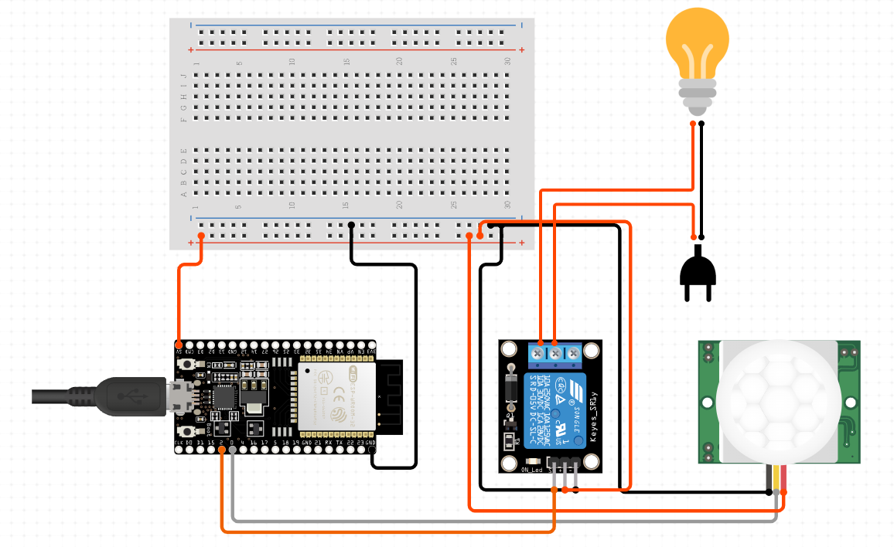
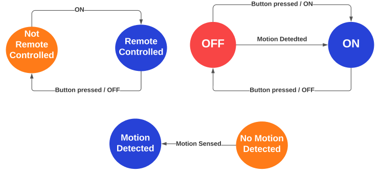

# ESP8266 Motion Sensor and MQTT Controlled Smart Outlet (QubeLink)

This project demonstrates how to use an ESP8266 with a PIR motion sensor and a smart outlet that can be controlled via MQTT. It uses the `WiFiManager` library for easy WiFi configuration and `EEPROM` to store the MQTT server address.

## Components

- ESP8266 (e.g., NodeMCU)
- PIR Motion Sensor
- Smart Outlet
- 220v ac to 5v dc adapter
- Jumper wires

## Libraries Required

- `ESP8266WiFi`
- `WiFiManager`
- `PubSubClient`
- `EEPROM`

## Circuit Diagram

- Connect the PIR motion sensor to pin `D1`.
- Connect the smart outlet control pin to `D2`.
- Connect a status LED to pin `D3` (optional).
  

## State Diagram

## Code

### Prerequisites

Make sure you have the following libraries installed in your Arduino IDE:

1. `ESP8266WiFi`
2. `WiFiManager`
3. `PubSubClient`
4. `EEPROM`

### Code Explanation

1. **Include Libraries**:
   The code includes necessary libraries for WiFi, MQTT, and EEPROM.

2. **Define Pins**:
   Pins for the PIR sensor, smart outlet, and a connection status LED are defined.

3. **WiFi and MQTT Clients**:
   Initializes the WiFi and MQTT clients.

4. **Variables**:
   Variables for storing the MQTT server address and tracking states are declared.

5. **EEPROM Functions**:
   Functions to save and load configuration data to/from EEPROM are provided.

6. **WiFi Setup**:
   Uses `WiFiManager` to connect to WiFi or create a configuration portal if no credentials are available.

7. **MQTT Reconnect**:
   A function to reconnect to the MQTT broker and subscribe to a topic.

8. **MQTT Callback**:
   Handles incoming MQTT messages to control the smart outlet.

9. **Setup Function**:
   Initializes serial communication, EEPROM, WiFi, MQTT, and pin modes.

10. **Main Loop**:
    Ensures the MQTT client stays connected and processes incoming messages. Checks the state of the motion sensor and updates the smart outlet state if not controlled by MQTT.

## How to Use

1. Upload the code to your ESP8266 using the Arduino IDE.
2. Connect to the "AutoConnectAP" WiFi network created by the ESP8266.
3. Open a web browser and go to `192.168.4.1`.
4. Enter your WiFi credentials and the MQTT server address.
5. The ESP8266 will connect to your WiFi and MQTT broker.
6. Use MQTT messages to control the smart outlet:
   - Send `1` to the `smart-outlet/status` topic to turn on the smart outlet.
   - Send `0` to the `smart-outlet/status` topic to turn off the smart outlet.
   - Send `request` to the `smart-outlet/status` topic to get the current state of the smart outlet.

## Notes

- The smart outlet state can be controlled manually using the PIR motion sensor or remotely via MQTT messages.
- The connection LED will indicate whether the ESP8266 is connected to the MQTT broker.
